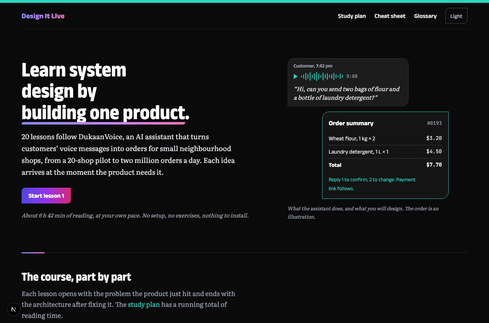
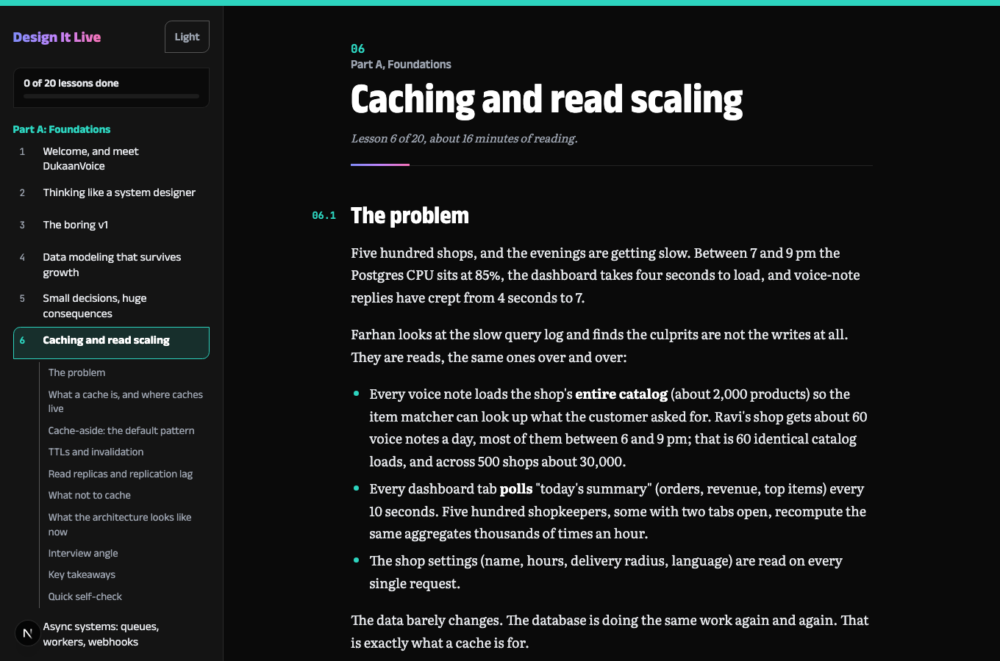

# Design It Live

A self-paced system design course for developers, built as a fast, fully static Next.js site.

Twenty lessons follow one fictional AI product, **DukaanVoice**, a voice-ordering assistant for small neighbourhood shops, from a 20-shop pilot to 50,000 shops and a festival night at ten times normal traffic. Every concept (queues, caching, idempotency, LLM gateways, RAG, agents, evals, guardrails, cost, sharding, offline-first apps) appears at the moment the product needs it.

- About **6 h 40 min** of reading (~54,000 words) in three parts, at your own pace
- Reading only: no setup, no exercises
- More than half on AI system design, the rest on core distributed systems
- Every lesson has diagrams, short TypeScript snippets, decision cards, an interview angle, takeaways and a 3-question quiz

**Live site:** _add your Vercel URL here_





## Lessons

| # | Lesson | Part | Minutes |
| --- | --- | --- | --- |
| 1 | Welcome, and meet DukaanVoice | A | 14 |
| 2 | Thinking like a system designer | A | 20 |
| 3 | The boring v1 | A | 18 |
| 4 | Data modeling that survives growth | A | 20 |
| 5 | Small decisions, huge consequences | A | 24 |
| 6 | Caching and read scaling | A | 16 |
| 7 | Async systems: queues, workers, webhooks | A | 20 |
| 8 | LLMs as a system component | B | 19 |
| 9 | The voice pipeline | B | 20 |
| 10 | The LLM gateway | B | 21 |
| 11 | Structured outputs and tool calling | B | 19 |
| 12 | RAG done right | B | 22 |
| 13 | Agents vs workflows | B | 20 |
| 14 | Context engineering and memory | B | 17 |
| 15 | Evals and AI observability | B | 19 |
| 16 | Safety, guardrails and privacy | B | 22 |
| 17 | AI cost engineering | B | 21 |
| 18 | Diwali night: scaling to millions | C | 25 |
| 19 | Frontend and mobile decisions that matter | C | 22 |
| 20 | Ship it, and the interview playbook | C | 23 |

Part A: 2 h 12 min. Part B: 3 h 20 min. Part C: 1 h 10 min. The site also has a study plan with a running total, a cheat sheet of all 40 decision cards, and a glossary of 182 terms.

## Run it locally

Requires Node.js 20.9 or newer.

```bash
npm install
npm run dev      # http://localhost:3000
```

Other scripts:

```bash
npm run build    # static production build
npm run lint     # ESLint
npm run check    # content checks: lesson structure, quiz balance, decision ids, word counts
```

## How the project is organised

```text
app/                     routes (App Router)
  page.tsx               home page
  (course)/              pages with the course sidebar
    lessons/[slug]/      lesson page, statically generated for every lesson
    plan/ cheatsheet/ glossary/
  sitemap.ts robots.ts icon.svg
content/lessons/         one MDX file per lesson: 01-welcome.mdx ... 20-ship-it.mdx
components/              Diagram (Mermaid), Quiz, Decision, Interview, Takeaways, Callout, Sidebar, MarkDone
lib/course.ts            the course manifest: order, slug, title, part, day, minutes
lib/decisions.ts         every decision card (lessons and cheat sheet both read from here)
lib/glossary.ts          every glossary term, linked to its lesson
lib/progress.ts          "mark as done" progress in localStorage
scripts/check-content.mjs
PLAN.md                  design plan, canonical DukaanVoice numbers, course outline and quiz answer key
```

Progress is stored only in the reader's browser (`localStorage`). There is no backend, database or analytics.

## Add or edit a lesson

1. **Edit text:** open `content/lessons/NN-slug.mdx`. It is Markdown plus a few components. In prose, avoid a bare `<` or `{` (MDX treats them as JSX); write "under 200 ms" instead of "< 200 ms", or use inline code.
2. **Add a lesson:** add an entry to `LESSONS` in `lib/course.ts` (order, slug, title, part, minutes, summary), then create `content/lessons/NN-slug.mdx` with the same number and slug. Navigation, the study plan, the sitemap and progress tracking pick it up automatically.
3. **Follow the lesson structure**, which `npm run check` enforces: `## The problem`, concept sections, at least one `<Diagram>`, 1 to 3 `<Decision>` cards, `## Interview angle` with `<Interview>`, `## Key takeaways` with `<Takeaways>`, and `## Quick self-check` with a 3-question `<Quiz>`.
4. **Components:**

   ```mdx
   <Diagram fig="7.1" caption="Shown under the diagram." label="Text alternative for screen readers."
     chart={`flowchart TD
     A["Webhook"] --> B[("Queue")]
   `} />

   <Decision id="outbox-vs-direct" />   {/* card content lives in lib/decisions.ts */}

   <Interview ask="The interviewer's question" mistake="The common mistake.">

   - What they want to hear

   </Interview>

   <Callout title="Optional title" kind="note">Aside text. kind can be "note" or "warn".</Callout>

   <Quiz questions={[{ q: "Question?", options: ["A", "B", "C", "D"], answer: "B", why: "Explanation." }]} />
   ```

5. **Decision cards** are added in `lib/decisions.ts` with the lesson's slug; they then appear in that lesson and on the cheat sheet automatically. **Glossary terms** go in `lib/glossary.ts`.
6. Run `npm run check && npm run build` before committing. The check keeps quiz answers balanced across A to D.

## Deploy to Vercel

The site is fully static and needs no environment variables.

1. Create an empty repository on GitHub (no README or licence, since this repo has them).
2. Push this project to it:

   ```bash
   git remote add origin https://github.com/<your-username>/design-it-live.git
   git branch -M main
   git push -u origin main
   ```

3. Go to [vercel.com/new](https://vercel.com/new), sign in with GitHub, and **Import** the repository.
4. Vercel detects Next.js automatically. Leave the defaults (build command `next build`, no environment variables) and click **Deploy**.
5. After about a minute you get a `*.vercel.app` URL. Put it at the top of this README.

Optional: to use a custom domain for canonical URLs, the sitemap and Open Graph tags, set `NEXT_PUBLIC_SITE_URL` (for example `https://designitlive.dev`) in the Vercel project's environment variables and redeploy. Without it, the production `*.vercel.app` domain is used automatically.

Every later `git push` to `main` redeploys; pull requests get preview URLs.

## Tech

Next.js 16 (App Router, static generation), TypeScript, MDX via `@next/mdx`, Shiki through `rehype-pretty-code` for code highlighting, Mermaid rendered client-side for diagrams, and plain CSS with a small set of design tokens. Fonts: Anek Latin, Literata and JetBrains Mono.

The visual direction (dark engineer's notebook with a lime highlighter accent, plus a light mode behind a toggle) is written down in [DESIGN.md](DESIGN.md). UI work follows the antislop rules in `.claude/skills/`; see the pointer at the end of `AGENTS.md`.

## Licence

- Code: [MIT](LICENSE).
- Course text, diagrams and quiz content in `content/`, `lib/decisions.ts` and `lib/glossary.ts`: [CC BY 4.0](CONTENT-LICENSE.md).

DukaanVoice, its shops and its people are fictional. Prices, model costs and vendor details in the course are illustrative; check current vendor documentation before relying on them.
